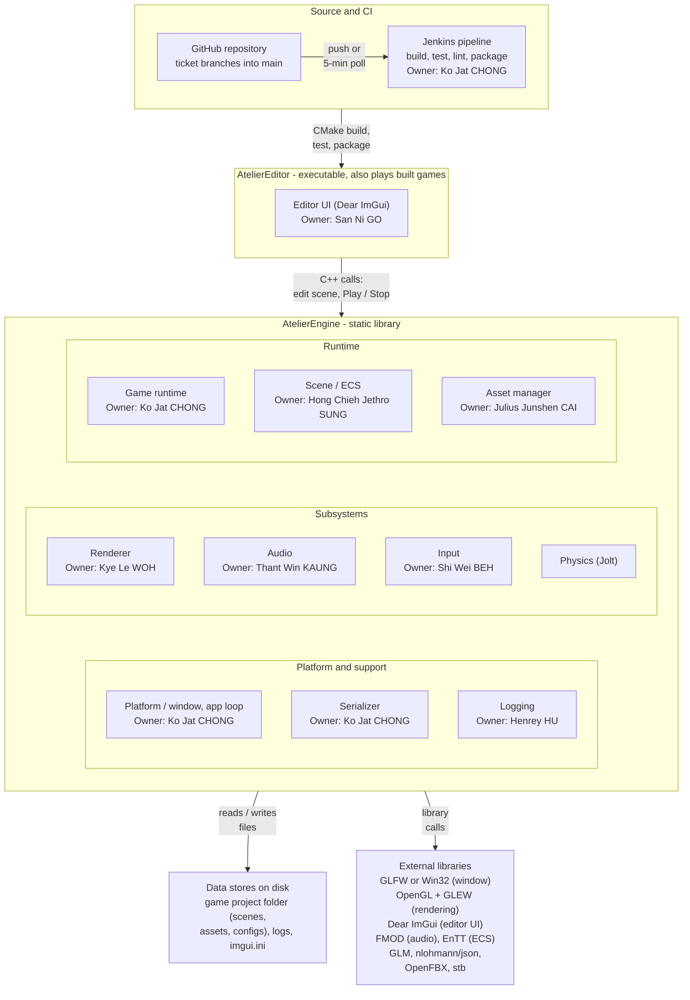

# Architecture

This document describes the system as it is implemented today in `apps/desktop/`. The product vision and the planned features (the block virtual machine, the in-world debugger, Teaching Mode lessons) are described in the [README](../README.md) and the [Product Design Document](design/product-design.md); what is [not implemented yet](#not-implemented-yet) is listed at the end.

## Overview

This is Architecture v0.1, the architecture at Milestone 1. Atelier3D is a desktop application built on a custom C++20 engine. The code is one static library and one program, the editor. Games are folders of data that the editor creates, edits, plays and builds. The diagram shows the components and their owners, the data stores, the external libraries and the Jenkins pipeline:



The arrows show how the parts communicate. The editor and the engine run in one process, so a "C++ call" is a plain function call. The groups inside AtelierEngine are by role, not strict layers. Each owner is the owner of the matching deliverable in the [README](../README.md#milestone-1-deliverables-and-jira); the platform and the game runtime, which have no deliverable of their own, belong to the tech lead. The modules are described one by one under [Engine](#engine), with their deliverable and ticket. How the components talk to each other:

| From | To | How they communicate |
|---|---|---|
| GitHub | Jenkins | A push webhook (or a poll every 5 minutes) starts the pipeline, which checks out `main` and runs the scripts in `tools/ci/` |
| Jenkins | Editor and engine | CMake builds for Linux and Windows, the GoogleTest suite, clang-format, clang-tidy and cppcheck, then packages and downloads |
| Editor UI | Game runtime | Direct C++ calls: the editor edits a `SceneDescription`; Play starts a new `GameRuntime` from it and Stop discards it |
| Editor UI | Platform and app loop, Logging | The editor is an `Application`, driven by the window and frame loop; its Console panel reads the Logger's in-memory sink |
| Game runtime | Scene / ECS, Asset manager, Serializer | It builds ECS entities from the scene, loads each object's assets through the `ResourceManager` (cache, reference counts, placeholders) and reads and writes scene and config files |
| Scene / ECS | Renderer, Audio, Input | Each frame the systems run: `RenderSystem` draws, `AudioSystem` plays voices and moves the listener, `PlayerControllerSystem` reads the named actions |
| Game runtime, block logic, editor | Each other | Events on the `EventBus` (see [Event system](#event-system)): the runtime announces what happened (Play start and stop, input, collisions, timers), `LogicRunner` starts the matching hat scripts, and the editor's Diagnostics window logs every event |
| Platform / window | Input | Window events (Win32 messages, or GLFW callbacks on Linux) update the `InputSystem`; `GameInput` hides them from the game while an editor panel has the keyboard or the mouse |
| Engine | Data stores | Versioned JSON scenes, the INI-style `game.cfg`, `input_actions.json` and assets by path; session logs in `logs/` and the window layout in `imgui.ini`, next to the executable |
| Engine | External libraries | Win32 or GLFW + X11 for the window, OpenGL through GLEW for drawing, FMOD for sound, Jolt for physics, Lua for scripts, Dear ImGui and ImGuizmo for the editor UI; EnTT, GLM, nlohmann/json, OpenFBX and stb inside the modules. assimp is not here: it is allowed for tools only, so it lives in the asset tool (see [Asset tool](#asset-tool)) |

The code builds into three targets:

| Build target | Kind | What it is |
|---|---|---|
| `AtelierEngine` | Static library | The engine modules listed under [Engine](#engine) |
| `AtelierEditor` | Executable | The editor. The same executable is also the game runtime: started with `--play`, or copied next to a `game/` folder by a game build, it plays that game instead of opening the editor |
| `AtelierTests` | Executable | The GoogleTest unit tests in `tests/unit/`. It links the engine and includes the editor's header-only classes |

## Engine

`projects/atelier_engine`. Public headers are in `include/engine/<module>/`, and each module's sources are in `src/<module>/`. `engine/Engine.hpp` includes the main public headers in one go.

| Module | Responsibility | M1 deliverable |
|---|---|---|
| `core` | `Application`, the base class of every program with a main loop (the editor and the game runtime): it owns the window and the audio system and calls `OnInit`, `OnUpdate` and `OnShutdown`. Logging: `Logger` (thread-safe; the minimum level can be changed at runtime), the `LOG_DEBUG` / `LOG_INFO` / `LOG_WARN` / `LOG_ERROR` macros (each message has a timestamp, level and category), and three sinks: `ConsoleSink` (terminal, coloured by level), `FileSink` (one file per session, the 10 newest kept) and `MemorySink` (feeds the editor Console). `StdCapture` sends `printf` / `std::cout` / `std::cerr` output into the log. `Time` for frame timing | T15 [ATE3D-57] |
| `platform` | The `Window` interface (window, OpenGL context, input forwarding, display scale, fullscreen) with a Win32 backend on Windows and a GLFW + X11 backend on Linux (`CreateWindow` picks one). `ExecutablePath` / `ExecutableDir`, used to find files next to the running executable | |
| `graphics` | OpenGL 3.3 rendering. `GraphicsManager` (frames) owns `Renderer`: the built-in shapes, the sky and the ground grid, lit by a `LightingContext` inside an `Environment` (sky colours and distance haze). Lighting is Blinn-Phong with one directional light (the sun), up to 8 point lights and sky / ground ambient light. `MeshRenderer` draws a `Mesh` with a `Material` (albedo tint and texture). Also `Camera3D`, `Shader`, `Texture` / `TextureGL`, and `FramebufferGL`, the offscreen target the editor Viewport is drawn into. The built-in shaders are `Standard3D` (lit), `Unlit`, `FallbackUnlit` and `Sky` | T12 [ATE3D-35] |
| `scene` | The entity component system (`Scene`, built on EnTT), its components and the systems that run them: see [Entity component system](#entity-component-system). `SceneDescription` is the authored scene (a tree of game objects with optional components; `Hierarchy` walks it and places children relative to their parents), and `SceneFile` reads and writes it as versioned JSON. `Prefab` and `PrefabInstance`: see [Parents and prefabs](#parents-and-prefabs) | T16 [ATE3D-59], T13 [ATE3D-15] |
| `game` | `GameProject` (find, load, create and import into games; reads and writes their files with `serializer`), `GameRuntime` (plays a scene: see [From scene file to frame](#from-scene-file-to-frame)), `GameBuild` (builds a standalone game), `PrefabManager` (a game's prefabs and their instances: see [Parents and prefabs](#parents-and-prefabs)) and `Shape` (the built-in shapes and their names in scene files) | |
| `editor` | `EditorScene`: the `SceneDescription` being edited, plus the selection, new object ids and snapshots for undo / redo; removing, copying and reparenting take an object's children with it. `TutorialNotes`: the notes shown on the editor's Modes page | T18 [ATE3D-60] |
| `serializer` | The `ISerializer` interface with `CFGSerializer` (INI / CFG files with sections) and `JSONSerializer` (nlohmann/json; nested objects and arrays) | T13 [ATE3D-15] |
| `assets` | `Resources` (the file loaders: `.amodel` (the engine's own model format, see [Asset tool](#asset-tool)), `.obj` and `.fbx` models, `.png` / `.jpg` textures, `.vert` + `.frag` shaders, `.wav` / `.ogg` audio, and the placeholder assets), `ResourceManager` (a handle-based cache: each file is read from disk once, shared by reference count, released when unused, replaced by a placeholder when missing, and reloaded when the file comes back) and `AssetGpuCache` (uploads assets to the GPU on first use) | T14 [ATE3D-14] |
| `audio` | `AudioSystem`: wraps FMOD Core for loading clips, playing voices (play, pause, stop, loop, volume), the Music and SFX buses under a master volume, a data-driven sound bank (`sounds.json`) and 3D positional audio with a listener | T17 [ATE3D-89] |
| `input` | `InputSystem` (keyboard and mouse state: pressed, held, released; mouse position, movement and scroll), `InputActions` (named actions loaded from `input_actions.json`) and `GameInput` (what game code sees: it reports nothing while the editor UI has the keyboard or the mouse) | T19 [ATE3D-10] |
| `ui` | `ImGuiLayer`: sets up Dear ImGui (docking, fonts, the OpenGL backend) and wraps each UI frame | T18 [ATE3D-60] |
| `logic` | The block language: `Blocks` (the kinds of block, their shapes and labels, ids, the rules for where a block fits) and `LogicRunner` (runs objects' scripts in Play mode). See [Block logic](#block-logic) | |
| `messenger` | The event system: `EventBus` (typed publish/subscribe: `Subscribe` returns a `Subscription` that unsubscribes when destroyed; `Emit` delivers now, `Enqueue` at the start of the next frame), `Events.hpp` (the event types) and `EventRegistry` (every event's name, sender and fields). `Application` owns the bus (`GetEvents()`). See [Event system](#event-system) | ATE3D-270 |

Audio uses FMOD on Windows and 64-bit Linux. FMOD's libraries are in `apps/desktop/libraries/lib/FMOD/windows/` (Windows: `fmod.dll`, `fmod_vc.lib`) and `apps/desktop/libraries/lib/FMOD/linux/` (64-bit Linux: `libfmod.so.14`), with the headers in `libraries/include/FMOD/api/`. Visual Studio and Linux GCC link FMOD's C++ API directly; MinGW (the Windows build Jenkins makes) goes through `src/audio/FmodMinGWBridge.cpp`, which implements the C++ calls the engine makes on top of FMOD's C API. Linux executables find `libfmod.so.14` in their own folder (the build copies it there). Builds without FMOD compile a silent backend with the same API, so the engine runs without sound instead of failing. The CMake option `ATELIER_ENABLE_FMOD` overrides the default.

### Block logic

A game object's logic (`GameObject::logic`, a `Logic::LogicDesc`) is the scripts of its block canvas: each script is a list of blocks where it lies on the canvas, and blocks hold the blocks inside them (the body of a C block, the condition in each slot), so the logic is a tree. The scene file saves it under `"logic"`, each block with only the fields its kind has: `{ "id": 3, "block": "repeat", "numbers": [10], "body": [ ... ] }`. Unknown blocks, blocks where they cannot be and repeated ids are fixed with warnings when read.

One table (`Logic::AllBlocks`) describes every kind of block: its name in the file, category (Events, Motion, Looks, Loops, Conditions, Math, Variables, Sensing, Health, close to Scratch's colours), shape and label (`"move forward %n"`, `"if %c then"`). The shape says where a block fits: a **hat** starts a script, **stack** blocks go one under another, a **cap** (forever, stop) ends one, a **condition** fits a hexagonal slot, and a **value** (a variable, math, the timer, a position, a distance) fits any number, so numbers can be worked out while the game runs. `CanInsert`, `CanFillSlot` and `CanFillInput` are the rules the editor uses to refuse illegal connections. Each object also has its own **variables** (`LogicDesc::variables`, with the value each starts at), saved under `"variables"`.

`GameRuntime` gives each object's logic to a `LogicRunner` when it starts, starts an object's scripts again when an edit changes them, and steps the runner every frame of Play mode before the other systems. Each script under a hat is a thread of its own, run like Scratch: "when Play starts" scripts run once, "when key pressed" ones each time the key goes down, "when I receive" ones each time any object broadcasts their message; a loop goes round once per frame and "wait" and "glide" wait across frames, so learners can watch each step, and no script runs more than 10,000 blocks in a frame. Motion blocks change the Transform (a child's relative to its parent), Looks the mesh renderer, Health the Health component. The runner reports the blocks that ran in the last 0.3 seconds (the editor makes them glow) and, once per block, a plain-language problem when a block needs a component the object does not have ("Cube has no Transform, so it cannot move").

**My Blocks**, the block library (`Logic::Library`, saved per game in `data/library.blocks.json`) keeps long stacks under a name, so a script can stay short: "when Play starts > Movement Logic". In the Blocks window, right-click a block and pick **Save as My Block**: it and the blocks under it (after a hat) are saved, and a single library block (`Op::Call`) takes their place. Library blocks are in the palette's My Blocks category, for any object in any scene of the game; **Unpack** puts a library block's blocks back to change them, and saving again under the same name updates it. `LogicRunner` runs a library block's blocks as if they were in the script (it carries on after it when they end); while they run, the library block in the script glows and is where their problems are reported. Library blocks can use library blocks, and one that keeps running itself is stopped with a problem. The editor saves the library on every change and the running game picks it up (`GameRuntime::SetLibrary`); library changes are not part of Undo.

### Event system

Systems announce what happened as **events** (plain structs in `engine/messenger/Events.hpp`) on one `EventBus`, owned by `Application`; whatever needs to react subscribes. Senders and listeners never call each other directly.

```text
Application (window) ─────┐
GameRuntime ──────────────┤                    ┌──▶ LogicRunner: starts "when …" hat scripts
  (Play, input, physics)  ├──▶  EventBus  ──────┼──▶ TimerSystem: counts timers down
LogicRunner (blocks) ─────┤   Emit / Enqueue   └──▶ Diagnostics window: "Game events" log
TimerSystem ──────────────┘
```

- **Subscribing**: `bus.Subscribe<Events::X>(handler)` returns a `Subscription`; the handler stays registered while it lives, so the listener keeps it as a member (declared last).
- **Sending**: `Emit` runs the handlers now, in the order they subscribed; `Enqueue` keeps the event for `DispatchQueued`, which `Application::Run` calls at the start of each frame. Events enqueued while the queue is delivered wait for the next frame.
- The bus is for the main thread. Handlers may subscribe, unsubscribe and send events.

| Event | Sent by | When |
|---|---|---|
| `WindowResized` | `Application` | The window's size changed |
| `GameStarted`, `GameStopped`, `SimulationChanged` | `GameRuntime` | A Play run starts, ends, is paused or resumed (never for the editor's edit-mode view) |
| `GameUpdate` | `GameRuntime` | Every frame while playing |
| `ActionPressed`, `ActionReleased`, `KeyPressed` | `GameRuntime` | A named action or a key went down or up while playing |
| `CollisionBegan`, `CollisionEnded` | `GameRuntime` | The physics reported two scene objects starting or stopping touching |
| `MessageBroadcast` | `LogicRunner`, engine code | A "broadcast" block ran (with its object and number), or engine code sent a message to the blocks |
| `TimerStarted`, `TimerElapsed` | `LogicRunner`, `TimerSystem` | A "start timer" block ran; a timer ran out |

`EventRegistry` lists the same events by name, with their fields, for tools such as the debugger.

**Blocks and events.** `GameRuntime::SetEventBus` connects the bus to the game: it passes collisions, timers that ran out and messages from engine code to `LogicRunner`, whose hats start on its next update: `when I touch [object]`, `when timer [name] ends` and `when I receive [message]`. The other way, `broadcast [message]`, `broadcast [message] with [n]` (the receivers read the number as `message value`) and `start timer [name] for [n] seconds` are sent on the bus. `TimerSystem` (`engine/game`) keeps the timers by name: they count down only while the game simulates and are cleared when it stops.

**Rules.** Never `Emit` inside `Scene::ForEach` or while `LogicRunner` walks its objects (a handler that adds or removes entities would break it): the runner `Enqueue`s, and `GameRuntime` sends collisions after the physics steps. `GameRuntime::Stop` clears the queue, so an event of one run never reaches the next.

### Entity component system

`Scene` wraps an EnTT registry, so the rest of the engine never touches EnTT directly. Entities have unique ids that are never reused. Only the types listed in `scene/Components.hpp` can be components, which is checked at compile time.

| Component | Data | Used by |
|---|---|---|
| `TransformComponent` | Position, rotation in degrees around X / Y / Z, uniform size and per-axis scale | Every system |
| `MeshRendererComponent` | Built-in shape or mesh handle, texture and shader handles, visibility, albedo tint | `RenderSystem` |
| `LightComponent` | Type (directional, point or spot), colour, intensity, range, spot cone angles, enabled | `RenderSystem` |
| `CameraComponent` | Field of view, near and far planes, and `primary` (the Main camera) | `RenderSystem` |
| `AudioSourceComponent` | Clip, volume, loop, play on start, 3D on / off, minimum and maximum distance, bus | `AudioSystem` |
| `PlayerControllerComponent` | Speed, fast multiplier, look sensitivity, follow-camera distance, height and pitch | `PlayerControllerSystem` |
| `SpinComponent` | Degrees per second around Y | `SpinSystem` |
| `HealthComponent` | Health and maximum health (plain data for game logic) | |
| `HierarchyComponent` | A child's parent entity and its transform relative to it | `HierarchySystem`, `SpinSystem` |
| `EntityIdComponent` | The entity's id (managed by `Scene`) | `Scene` |

| System | What it does each frame |
|---|---|
| `RenderSystem` | Points the camera through the Main camera, collects the scene's lights for the renderer, and draws every visible entity that has a Transform and a MeshRenderer |
| `AudioSystem` | Starts, pauses and stops each AudioSource's voice, pushes its volume, position and range to FMOD, and keeps the listener on the camera |
| `PlayerControllerSystem` | Moves the player from the input actions, turns it with the mouse, and keeps the Main camera behind a player whose camera follows |
| `SpinSystem` | Turns entities that have a SpinComponent (a child turns relative to its parent) |
| `HierarchySystem` | Places every child entity from its parent's Transform and its own local one, parents first |

Spot lights can be saved in a scene and edited in the Inspector, but the lit shader shades only the directional light and point lights so far.

### From scene file to frame

A scene exists in three forms, each with one job:

```text
data/scenes/*.json ──SceneFile──▶ SceneDescription ──GameRuntime──▶ Scene (ECS entities)
   saved scene                    authored scene:                   live state the systems
   (versioned JSON)               game objects with optional        run over each frame
                                  components; asset paths
                                        ▲
                                        │ edited by
                                  EditorScene (editor)
```

- **`SceneFile`** loads and saves a `SceneDescription`. Saving is deterministic, so saving a scene that was just loaded gives the same file.
- **`SceneDescription`** is shared by the scene file, the editor and the runtime. Plain-data components are the ECS's own types; the two that refer to assets (`RenderableDesc`, `AudioSourceDesc`) hold file paths.
- **`GameRuntime`** is the only place a `SceneDescription` becomes ECS entities: it loads each object's assets through the `ResourceManager` and adds the matching components. While a scene is running, `UpdateScene` applies an edited `SceneDescription` by matching objects by id and touching only what changed, so a component added or removed in the Inspector takes effect on the next frame and everything else keeps its live state.

`Application::Run` drives one frame as: `OnUpdate` (the editor or the game), the audio mixer, present, then poll window events. Inside `OnUpdate`, `GameRuntime::Tick` does the following:

1. Checks for asset files that disappeared or came back (`ResourceManager::Update`).
2. In Play mode only: `SpinSystem`, `AnimationSystem` (moves each playing Animator on through its clip), then `PlayerControllerSystem` with the frame's `GameInput`.
3. `HierarchySystem`: children follow their parents (in edit mode too).
4. When the game camera is in use: places it from the Main camera, kept behind a following player.
5. `AudioSystem`: moves the listener to the camera, then updates every AudioSource (paused when not in Play mode).
6. `RenderSystem`: collects the lights, draws the sky, then draws the entities (and the ground grid in the editor).

While playing, `Tick` also sends the frame's events (see [Event system](#event-system)): the input events and `GameUpdate` after the player controller, the collisions after the physics steps, then it counts the timers down.

### Skeletons and animation

A model can carry skeletons and animations (`ModelData::skins` and `animations`, read from `.gltf` / `.glb` by `GltfLoader`, kept from FBX and the other formats by the asset tool, and stored in `.amodel` version 2). A skin's joints are nodes of the model, with an inverse bind matrix each; a skinned mesh holds four joints and weights per vertex. A clip is a list of channels, each moving one node's translation, rotation or scale through keyframes (linear or step; glTF cubic splines are played linearly).

Drawing is GPU skinning: `Graphics::Model::Draw(model, camera, clip, time)` samples the clip into node transforms (`Assets::SampleClip`), places every node from the root (`NodeWorlds`), and draws each skinned mesh from the model's root with `u_Skinned = 1` and its bones (`jointWorld * inverseBind`, at most `kMaxBones` = 128) in `u_Bones`; `Standard3D.vert` blends them by the vertex's weights. Meshes without a skin are drawn at their node, so clips also move rigid parts. An object plays a clip through its `AnimatorComponent` (`animator` in scene files: clip name, playing, loop, speed); without one, the model stands at rest. The Looks blocks `play animation`, `play animation … once`, `stop animation` and `set animation speed` change it while the game runs.

### Materials, shaders and model turn

A material is a `.amat` file (JSON, `Assets::MaterialFile`) in `assets/art/materials/`: a shader (empty for `Standard3D`, or a game's own `.vert` with its `.frag` beside it in `assets/shaders/`), a colour, a texture, glow, metal and roughness, and named float values a custom shader reads as uniforms. A Renderable's `material` names one; `RenderSystem` draws its shape, mesh or model with it (a model's own materials are replaced). `GameRuntime` loads each material once (its shader and texture through the `ResourceManager`), shares it between objects, and reads it again within a second of it being saved; the `ResourceManager` reads saved shaders and textures again too, and `AssetGpuCache` recompiles or re-uploads them by their version. `GameProject::CreateShader` starts a shader from a copy of the standard one.

Level of detail is automatic: when the `ResourceManager` loads a model it makes simpler versions of it (`MeshSimplifier`, cached in the temp folder), and `RenderSystem` draws the one that suits the model's size on screen each frame, see Level of detail.

A Renderable's `model_turn` turns its model or mesh round Y inside the object (its collider box turns with it) without turning the object or the way it walks. glTF models face +Z and the engine's forward is -Z, so `GltfLoader` and the asset tool turn them 180 degrees when they are read or imported.

### Parents and prefabs

Each `GameObject` has a `parent` (0 = at the top of the scene), and a child's Transform is relative to its parent's. `Scene/Hierarchy.hpp` walks the tree (`ChildrenOf`, `SubtreeOf`, `CanSetParent`) and works out where an object is in the world (`WorldMatrixOf`, `WorldTransformOf`); the editor's Viewport draws, picks and moves objects through it, and `GameRuntime` gives each child entity a `HierarchyComponent` so `HierarchySystem` keeps it with its parent at run time.

A **prefab** is a group of objects saved to be placed again and again: a root and everything under it, in `assets/prefabs/<name>.prefab`.

```text
{ "version": 1, "name": "Enemy",
  "objects": [ { "id": 1, "name": "Enemy", "transform": { ... }, "health": { ... } },        <- the root, always id 1
               { "id": 2, "name": "Head", "parent": 1, "transform": { ... }, ... } ] }    <- laid out as in a scene file
```

An **instance** is an ordinary group of scene objects. Each of them has a `PrefabInstance` component that names the prefab file, the prefab object it copies, and its **overrides**: the properties changed on this instance only, as paths in the scene file layout (`health/health` for one field, `light` for a whole component added or removed). The root's name and Transform belong to each instance (where it was placed), so they are never overrides. Because the instance holds all of its own data, a scene plays the same without the prefab file; the link is only used to keep instances up to date.

`Game::PrefabManager` does the work, comparing objects through their scene file JSON:

| Operation | What it does |
|---|---|
| `CreatePrefab` | Saves an object and everything under it as a new prefab; the objects become its first instance |
| `Instantiate` | Adds a linked copy of a prefab to the scene at a given place |
| `RefreshOverrides` | Records what each instance object has that differs from its prefab object (the editor calls it with every committed edit) |
| `UpdateInstances` | Brings instances up to date with their prefabs: properties that are not overridden take the prefab's values, and parts the prefab gained or lost are added or removed (the editor calls it when a scene opens) |
| `Revert` | Sets one property (or all of them) back to the prefab's value |
| `ApplyToPrefab` | Writes an instance back into its prefab file (objects added under it become parts of the prefab), then updates every other instance, keeping their overrides |
| `Unpack` | Turns an instance back into plain objects |
| `Contains` | Whether a prefab is another one, or has it as a base or nested in it at any depth (placing it there would make a prefab that contains itself) |

A part of an instance cannot be deleted, duplicated or moved to another parent in the editor: the prefab decides those, so the change would be undone at the next update. Unpack the instance, or change the prefab and apply it.

**Nested prefabs** are whole instances of other prefabs under a prefab's root (a *Squad* prefab holding two *Enemy* instances). In the prefab file they are laid out like instances in a scene: each of their objects keeps its `PrefabInstance` link to the inner prefab, and the overrides the outer prefab made (the second enemy's health, say). Scene objects only ever link to one prefab, the outermost: an instance of the Squad links every object to the Squad. When `PrefabManager` reads a prefab it first brings its nested instances up to date with their prefabs (the same way it brings a variant up to date with its base), so a change to the Enemy reaches the Squad, and from there every Squad instance, except what the Squad or that instance overrode. A prefab gets nested ones by being made from a group that holds whole instances (`CreatePrefab`), by applying an instance with an instance of another prefab added under it (`ApplyToPrefab`), or by placing a prefab in Prefab Mode. A prefab never contains itself: the editor and `ApplyToPrefab` refuse that, and hand-written files that do are read without going round in circles. Deleting a prefab keeps its objects in the prefabs it was nested in, no longer linked.

## Editor

`projects/atelier_editor`. `EditorApp` is an engine `Application` whose frames are drawn by `SceneEditor`. `main` also handles the command line:

| Command | What it does |
|---|---|
| `AtelierEditor` | Opens the editor, or plays the game in `game/` next to the executable if there is one (a built game) |
| `AtelierEditor --new-game <name> [--template empty\|rpg\|fps\|racing\|rendering\|resources\|ecs\|audio\|input\|prefabs] [--projects-dir <dir>]` | Creates a game project without opening a window |
| `AtelierEditor --build-game <name\|path> [--output <dir>] [--projects-dir <dir>]` | Builds a standalone copy of a game |
| `AtelierEditor --play <name\|path> [--scene <file>]` | Plays a game, or one of its scenes, in its own window |

`SceneEditor` draws a menu bar (File, Edit, Project, Window) with Play / Pause / Stop, a *Modes* home page with tutorial cards, and a workspace of docked windows:

| Window | What it shows | Code |
|---|---|---|
| Viewport | The scene in 3D or 2D, drawn into a `FramebufferGL`. Edit mode: selection, move / rotate / scale gizmos (ImGuizmo), a view cube, a ground grid and the editor camera. Play mode: the running game. An overlay shows FPS and the entity count | `SceneEditorViewport.cpp`, `camera/EditorCamera.hpp`, `camera/View2D.hpp` |
| Hierarchy | The scene's game objects as a tree: create (Empty, Cube, Sphere, Plane, Directional Light, Point Light, Camera, Player, Create Child), select, rename, duplicate, delete, drag one onto another to put it under it, Save as Prefab. The Prefabs list places instances of the game's prefabs; instances are shown in blue | `SceneEditor.cpp` |
| Inspector | The selected object's components and their properties, with Add Component and Remove, and model / texture import. For part of a prefab instance: the prefab, each override with Revert, Apply to Prefab and Unpack; a component with an override is marked "(changed)" | `SceneEditor.cpp` |
| Assets, Loaded Assets | *Assets*, laid out like Unity's Project window: the game's `assets/` folder as a folder tree, a path to click back up, and the open folder's folders and files as tiles (search looks through every folder). **Import...** and **New Folder**, and files or folders dropped on the editor from the desktop's file manager are copied into the open folder (`Window::TakeDroppedFiles`, `SceneEditor::ImportDropped`). The files: models, textures and sounds as tiles with a search box, type and Favorites filters, pictures and hover previews, a play button on sounds and a favorite star; a click or a drag uses an asset on an object (see Asset Browser). *Loaded Assets*: the assets the running scene has loaded, with their reference counts and disk reads | `panels/assets/` (`AssetBrowserPanel`, `AssetCatalog`, `AssetPreviews`, `AssetFavorites`, `AssetDragDrop`, `AssetsPanel`), `SceneEditor.cpp` |
| Console | Every log message: timestamp, level, category; filters by level, category and text; clear; the minimum log level | `panels/console/` |
| Controls | The game's `input_actions.json`: view, rebind and save the actions | `panels/controls/` |
| Diagnostics | Frame rate, the ECS demo (spawn 1,000 copies of the selected object), editor camera values and the live state of the input system | `panels/diagnostics/`, `SceneEditor.cpp` |
| Audio | The sound bank: play and stop entries, voice counts, bus volumes, a 3D test emitter | `panels/AudioPanel.cpp` |
| Blocks | The selected object's block logic, Scratch-style: a palette of blocks by category on the left, and a canvas where puzzle-shaped blocks are dragged and snap together where they fit (illegal connections do not snap). Picking up a block takes the blocks under it along; dropping blocks on the palette deletes them. Fields are edited in place; right-click a block to duplicate or delete it, the canvas to tidy it; drag the canvas to look around, Ctrl + wheel to zoom. In Play mode running blocks glow yellow and blocks with a problem red | `panels/blocks/BlocksPanel` |
| Logic | Every object's scripts as indented sentences, with what is running and any problems while playing; a click selects the object and shows the block in the Blocks window | `panels/blocks/LogicPanel` |

Things worth knowing about how the editor works:

- **Edit mode and Play mode.** The editor keeps one `GameRuntime` for the selected game. In edit mode it is not simulating: the scene stands still and is drawn from the editor camera (`EditorCamera`). Play starts a new runtime from the scene as it is in the editor and draws from the game camera; Stop discards it, so the editor returns to the scene as it was before Play.
- **Editor input and game input are separate.** Game code only receives a `GameInput`, which reports no keys while an editor text field has the keyboard and no mouse while the pointer is over an editor panel.
- **Undo and redo** are commands (`engine/history/`: `UndoRedoManager`, `SceneCommands`). Creating or deleting an object (with everything under it) and gizmo drags record their own; other edits are recorded once finished, as the changed objects, or as a snapshot of the whole scene when objects were also added, removed or reordered (placing a prefab, Apply, Unpack, reparenting).
- **The Assets window does not edit the scene itself.** The editor tells `AssetBrowserPanel` which object is selected and what it uses; a click on a tile, or a drop on a Hierarchy row, the Viewport (picked like a click) or an Inspector field, comes back to `SceneEditor::UseAsset`, which sets the mesh, texture or Audio Source clip and adds the component if it is missing, so Undo covers it. Drags carry the asset's path in an ImGui payload with one type per kind, so only targets that can take it light up. Image previews are uploaded as textures and model previews rendered once into small framebuffers (`AssetPreviews`), a few per frame, after making sure GLEW is loaded: the Assets window can be drawn before the Viewport's first render.
- **The Simple interface has no Inspector.** Its one screen is laid out like Scratch: the Blocks editor down the left, and on the right the Viewport (16:9) over the Objects list (or *Assets*, or the lesson). The selected object is moved, turned and resized with the gizmo (Snap on the view's toolbar), and a small bar centred along the bottom of the view shows what it is, one swatch that opens its colours (and a light's brightness), and *Parts*, a popup with its parts and *+ Add a part*. A right-click on it in the list or in the view opens its menu: look at it, rename, change its parts, duplicate, delete, group, and for a copy of a saved object, change the saved object, make every copy like it, make it like the saved one again, or make it a normal object (`SceneEditor::DrawSimpleObjectBar`, `DrawSimpleObjectMenu`).
- **Simple's words for prefabs and assets.** Prefabs are *saved objects* and their instances *copies*; Prefab Mode is *Changing <name>* with Back to the scene and Save. The *Assets* tab lists the saved objects (Add, drag into the view, double-click to change one), then the game's files by kind (3D models, Pictures, Sounds) without folders or filters (`AssetBrowserPanel::DrawSimpleContents`).
- **My Blocks open in a window.** Double-click a library block (or Open in its menu or in the My Blocks category) to see and change its blocks with the same palette and canvas, on a stand-in object; Save puts them back in the library for every script that uses it (one stack, not starting with a "when" block). Unpack still puts a copy of them in the script.
- **Home's game pictures.** The Viewport's framebuffer is read back, made small and saved as `data/thumbnail.editor.bmp` in the game when its scene is saved, on the way Home and when the editor closes; the *Jump back in* tiles show it (a drawing stands in until a game has one). The *Create* card has one *New game* button; the templates are picked in its dialog.
- **Blocks and the physics.** `Game::BlockPhysics` is the `LogicRunner::PhysicsAccess` GameRuntime gives the blocks. On an object with a Dynamic Rigid Body, Motion blocks walk it: the frame's moves become its velocity for one physics step, so walls stop it and it pushes what it walks into. The Physics blocks jump (only when it stands on something), push it forward or along the axes, and ask whether it is on the ground or touching another object (`PhysicsBodyComponent::touching`). An object that walks, and a player, is a character: before each step its tilt and spin are taken away, and after a step it walked in its sideways speed is, so it never tips over and it stops when it stops walking. Each frame: the blocks, `BeforeStep`, `PhysicsSystem::Update`, `AfterStep`.
- **Playing with the mouse.** `Window::SetCursorCaptured` hides the pointer and holds it in the window (Win32: a 1 px `ClipCursor` in the middle and raw mouse input for the movement; GLFW: its disabled cursor), and `InputSystem::SetPointerLocked` tells the game, so the mouse turns the player with no button held. In the editor a click in the playing view takes it and Esc, Pause, Stop or leaving the window give it back (`SceneEditor::UpdatePointerLock`, which also turns ImGui's mouse off meanwhile); a built game takes it at the start and after a click.
- **The games' HUD** (`Editor::Runtime::DrawGameHud`, in the editor's fonts) is drawn over the game in Play and in a built game (which runs an `ImGuiLayer` for it): the player's Health, the variables blocks put on the screen (`show variable`, `LogicRunner::Monitors`), speech bubbles over whoever said something lately (`LogicRunner::Speeches`; a subtitle when off screen), a crosshair in first person and "Click to play".
- **Screen Elements: the game's 2D screen.** An object with a `ScreenElementComponent` (Create > Screen > Text, Picture, Bar or Button) is a thing on the game's screen, saved in the scene (`"screen"`). It is placed from an anchor (a corner, an edge or the middle) plus an offset in percent of the screen, sized in percent of its height, coloured, layered and shown or hidden. A bar is tied to a variable of an object (`bar_object`, `bar_variable`) and fills towards its maximum; a button (or any element whose object has a `when clicked on screen` script) can be clicked. While editing, the editor draws them over the view as the game will (hidden ones faintly): click one to select it, drag it to move it, drag its corner to resize it (`SceneEditor::EditScreenElements`); the Inspector and Simple's Parts show its fields. The Screen blocks act on the object's element (giving it one if it has none); blocks also show or hide the player's health bar and the crosshair, show an object's health above it, and lock or free the mouse. The HUD draws the running game's elements from the ECS (`Editor::Runtime::DrawScreenElement`) and hands clicks back through `GameRuntime::ScreenClicked`. A template copies the pictures its blocks and elements use into the new game.
- **Main menus.** A genre template with a `<name>_menu.json` scene beside it gives new games two scenes: `menu.json`, where the game starts, and `main.json`, the game itself; the menu's Play button (a Screen Element button) locks the mouse and goes to scene `main`.
- **Scenes and games.** The Scenes window (Advanced, under the Hierarchy) and the Simple interface's Scenes tab list the game's scenes: open one, make, rename, copy or delete it, and choose the one the game starts with. While playing, it says which scene the game is in: `go to scene` starts another one at the beginning of the next frame (`GameRuntime::SwitchedScene`). Delete Game... (right-click a game on the Home page, or the Project menu) and deleting a scene send them to the Recycle Bin (`Editor::MoveToRecycleBin`; a `Deleted games` / `.deleted` folder where there is none).
- **A plane is 1 x 1 times its size** (the renderer draws its 10 x 10 mesh at a tenth, and its collider matches): a 60 m ground has size 60.
- **The window layout** is saved in `imgui.ini` next to the executable and restored the next time the editor opens.
- **Logging.** The editor adds a `MemorySink` (the Console) and a `FileSink` (`logs/editor_<date>_<time>.log` next to the executable) to the logger, and starts `StdCapture`.

`runtime/RuntimeApp` is the game-only application used by `--play` and by built games: the same engine, no editor UI, with the window size and title taken from `game.cfg`.

## Game projects

A folder is a game project when it contains `configs/game.cfg`. Because games are data, adding one needs no C++ code or build change.

```text
<game>/
├── configs/game.cfg             INI-style (CFGSerializer): name, window_width, window_height, start_scene
├── configs/input_actions.json   JSON (Input::InputActions): { "version": 1, "actions": { "MoveForward": ["W"], ... } }
├── data/scenes/*.json           JSON (Scene::SceneFile): { "version": 8, "objects": [ ... ] }
├── data/tutorials.editor.modes  JSON (Editor::TutorialNotes): the notes from the editor's Modes page
├── data/assets.editor.favorites JSON (Editor::Panels::AssetFavorites): { "version": 1, "favorites": [ "assets/...", ... ] }
├── assets/                      by type: art/models/<name>/ (a folder per model: .amodel and its originals),
│                                art/textures/ (<name>/ per model), art/sprites/, art/spritesheets/, audio/,
│                                prefabs/*.prefab (Scene::Prefab), shaders/
└── scripts/
```

Each object in a scene file has an `id`, a `name` and, under another object, a `parent`, and lists only the components it has: `transform`, `renderable`, `audio_source`, `player`, `camera`, `light`, `health`, and `prefab` (its link to a prefab). The README section "Creating a New Game" documents every field.

`GameProject::ProjectsRoot()` is the `projects` folder inside the folder containing the running executable (`Platform::ExecutableDir() / "projects"`), so games are created and found next to `AtelierEditor`, wherever it was launched from. The folder is created with the first game. During development that is inside `apps/desktop/build/`, which is not committed and is cleared by `clean.bat` and CI builds.

`GameProject::Create()` makes the folder layout above (see [Asset tool](#asset-tool); games made with an earlier layout, with `assets/textures` or `assets/models`, are moved to it on open by `MigrateAssetLayout` in `engine/game/AssetLayout.hpp`), with an empty start scene or a template's scene (New Game offers the genre games `rpg`, `fps` and `racing`; the milestone demos are only for `--template`) and the asset files it uses, and it validates the name so a game cannot be created outside that folder. The templates are the scenes of the sample game **AtelierDemos**, which lives in `projects/atelier_editor/` (`configs/`, `data/scenes/`, `assets/`): `rendering`, `resources`, `ecs`, `audio`, `input` and `prefabs` (a player with three child objects, saved as the Enemy prefab, and five Enemy instances, one with different health). The build copies the sample game to `templates/demos/` next to the editor, where `GameProject::TemplatesDir()` finds it.

**Building games.** **Project > Build Game** (or `--build-game`) calls `Engine::Game::BuildGame`, which copies the running executable to `builds/<game>/<game>[.exe]`, the runtime libraries next to it, and the game's data to `builds/<game>/game/`. There is no game-specific code to compile. At startup the executable checks for a `game/` folder next to itself (`FindBuiltGame`); if there is one, it plays that game instead of opening the editor. A rebuild only replaces folders marked with `.atelier-build`, so it never deletes an unrelated folder.

Files the editor reads or writes next to its executable:

| Path | Contents |
|---|---|
| `assets/` | Editor assets and the built-in shaders (`assets/shaders/Builtin/`) |
| `templates/demos/` | The demo templates for new games |
| `projects/` | Game projects |
| `builds/` | Built games |
| `logs/` | Session log files |
| `imgui.ini` | The window layout |

## Asset tool

`AtelierAssetTool` (`projects/atelier_asset_tool`) turns model files from other programs (OBJ, FBX, glTF / GLB, Collada, 3DS, PLY, STL) into the engine's own `.amodel` file. The editor runs it when a model is imported. It is a separate program because the course allows assimp for tools but not for the engine: assimp is linked into the tool only, and the engine, the editor and built games read `.amodel` files without it.

A game's assets are sorted by type. `Engine::Game::MigrateAssetLayout` moves games made with an earlier layout to this one the first time they are opened:

```text
assets/
  art/
    models/<name>/     <name>.amodel (what the engine draws) and the files it was made from, to import it again later
    textures/<name>/   the images of model <name>, named in its .amodel by relative path
    textures/          images imported on their own, for 3D objects
    sprites/           2D images
    spritesheets/      sheets of frames for 2D animation
  audio/               sounds and music
  prefabs/
  shaders/             the engine's built-in shaders
```

- **Importing.** Inspector > Import and dropping files on the editor or the Assets window run the tool. A `.zip` or a folder holding one model is imported as a pack. Importing the same model again updates its folders; a different model with the same name gets `<name>_2/`. Warnings go to the Console and the model is still imported. Without the tool (`-DATELIER_BUILD_ASSET_TOOL=OFF`), `.obj` and `.fbx` files are copied as they are and other formats cannot be imported.
- **The conversion** triangulates, welds identical vertices, generates missing normals, and keeps the node hierarchy, one mesh per material, and each material's colours, metallic, roughness and images. Animations, skinning, lights and cameras are not kept: a skinned model comes in as its bind pose.
- **The `.amodel` format (version 1)** is little-endian: `"AMDL"`, `u32` version, name, materials, meshes, nodes, root list, and a trailing FNV-1a checksum. `engine/assets/loaders/AtelierModel.hpp` reads it and checks the magic, version and checksum.
- **By hand:** `AtelierAssetTool <input> <output> [--textures-dir <folder>] [--scale <factor>] [--fit <size>] [--center] [--model-folder]`. It prints `output: <file written>`, `warning:` lines for what it could not find, and `error:` with exit code 1 when it fails.

`tests/tool` (`AtelierToolTests`) converts real files and model packs and checks the result.

## Error handling

The engine reports a problem and carries on with a safe default instead of stopping:

| Situation | What happens |
|---|---|
| A scene file is missing, corrupt or a different version | An error naming the problem is logged. A game still starts, with an empty scene; the editor shows the error in its status bar and keeps the scene it had open |
| A field in a scene file is missing or has the wrong type | The field keeps its default, and an error is logged for it. Unknown components are skipped |
| `input_actions.json` is missing, corrupt or names an unknown key | The default bindings are used and the problem is logged |
| An asset file is missing or cannot be read | A placeholder is used (magenta texture, default cube, fallback shader, silence) and a warning names the file. If the file comes back, it is reloaded |
| A sound clip is missing, or audio cannot start | It is logged, and the engine runs without that sound |
| The log file cannot be created | A warning appears in the Console; the other log outputs keep working |

## Tests

`tests/unit/` holds the GoogleTest suite, built into `AtelierTests` when the CMake option `ATELIER_BUILD_TESTS` is on (off by default; the CI scripts turn it on). The tests need no window or OpenGL context, so they run on a CI node; the audio tests pass with FMOD (playing at volume 0) and with the silent backend. They cover the ECS and its systems, the scene file format (including the save → load → save round trip), the serializers, the resource manager, game projects, game builds, the runtime's live edits, block logic (the block rules, saving it, and running it), input, logging, audio, the editor scene and cameras, the Assets browser (listing, search, filters and favorites, on the sample game's assets), and every demo scene of the sample game. The README section "Running the Tests" lists the files and the commands.

The event system has its own tests: `EventBusTests` (delivery, queueing, handler order, several listeners), `BlockEventTests` (blocks and the bus: messages, touches, timers, message values), `TimerSystemTests` and `EventRegistryTests`.

## Build and CI

| | |
|---|---|
| Build system | CMake 3.20+, project root `apps/desktop/`. Visual Studio generator on Windows, Ninja + GCC on Linux, MinGW-w64 for Windows cross-builds (`cmake/mingw-w64-x86_64.cmake`) |
| Local scripts | `apps/desktop/run.bat` (incremental build into `build/dev`, then open the editor, create a game or build a game) and `clean.bat` |
| CI scripts | `tools/ci/`: `install-deps.sh`, `build.sh` / `build.bat`, `test.sh`, `lint.sh` (clang-format, clang-tidy), `static-analysis.sh` (cppcheck), `package.sh`, `publish-downloads.sh`, `publish-history.sh` |
| Pipeline | `Jenkinsfile`, on every push to `main`: install dependencies, Linux Debug build, unit tests, lint, static analysis, Linux Release build, Windows Release build (MinGW-w64), package, publish downloads |
| Checks | Only our code under `apps/` is linted and analysed; third-party code (`apps/desktop/libraries/`, CMake's `_deps/`) and the files listed in `.clang-format-ignore` are left out. clang-format differences, `bugprone-*` / `clang-analyzer-*` findings and cppcheck errors fail the build |
| Packages | `package.sh` ships the editor, `AtelierPlayer` (which exports copy) and `AtelierAssetTool` (which model import runs), with everything they read from next to themselves: `assets/` (including the built-in shaders), `templates/` and the runtime libraries (the DLLs on Windows; `libfmod.so.14` on Linux). It fails rather than ship a package that cannot draw or has no sound |

After building, CMake copies next to the editor executable the runtime libraries (the DLLs on Windows, `libfmod.so.14` on Linux), the editor assets and built-in shaders, and the demo templates. Setting up a machine, the IDE options and the checks to run before pushing are described on the wiki's [Development Setup](https://github.com/L1nceLin/Atelier3D/wiki/Development-Setup) page.

## Technology stack

| Concern | Choice |
|---|---|
| Language | C++20 |
| Build | CMake 3.20+ |
| Windowing | Win32 (Windows), GLFW 3.4 + X11 (Linux, fetched by CMake) |
| Rendering | OpenGL 3.3 with GLSL 3.30 shaders; GLEW (prebuilt on Windows, its source fetched by CMake on Linux); GLM for mathematics |
| Entity component system | EnTT |
| Editor UI | Dear ImGui (docking) and ImGuizmo |
| Assets | The engine's `.amodel` format, built-in OBJ loader, OpenFBX, stb_image, stb_vorbis; assimp in the asset tool only |
| Audio | FMOD Core (Windows and 64-bit Linux) |
| Physics | Jolt Physics (fetched by CMake) |
| Scripting | Lua |
| Data files | nlohmann/json, and the engine's own CFG serializer |
| Third-party code | Committed in `apps/desktop/libraries/` (assimp, entt, FMOD, GLEW, GLFW, glm, ImGui, ImGuizmo, json, Lua, OpenFBX, stb) |
| Tests | GoogleTest (fetched by CMake), in `tests/unit/` and `tests/tool/` |
| Checks | clang-format, clang-tidy, cppcheck, compiler warnings (`-Wall -Wextra`) |
| CI | Jenkins (`Jenkinsfile`) |

## Not implemented yet

These parts of the target architecture in the README and the Product Design Document do not exist in the code yet:

| Part | Planned for |
|---|---|
| Block compiler, intermediate representation and block virtual machine (`LogicRunner` runs the block tree directly for now) | MVP |
| Variables shared by all objects | MVP |
| The in-world debugger: a floating panel beside the object (execution highlighting, stepping and breakpoints are built) | MVP |
| Teaching Mode lessons with objectives and automatic checks (the Modes page and the Simple interface's Lesson tab are the starting point) | MVP |
| Generated C++ view | V2 |

[ATE3D-10]: https://digipen-team-apps-1.atlassian.net/browse/ATE3D-10
[ATE3D-14]: https://digipen-team-apps-1.atlassian.net/browse/ATE3D-14
[ATE3D-15]: https://digipen-team-apps-1.atlassian.net/browse/ATE3D-15
[ATE3D-35]: https://digipen-team-apps-1.atlassian.net/browse/ATE3D-35
[ATE3D-57]: https://digipen-team-apps-1.atlassian.net/browse/ATE3D-57
[ATE3D-59]: https://digipen-team-apps-1.atlassian.net/browse/ATE3D-59
[ATE3D-60]: https://digipen-team-apps-1.atlassian.net/browse/ATE3D-60
[ATE3D-89]: https://digipen-team-apps-1.atlassian.net/browse/ATE3D-89
