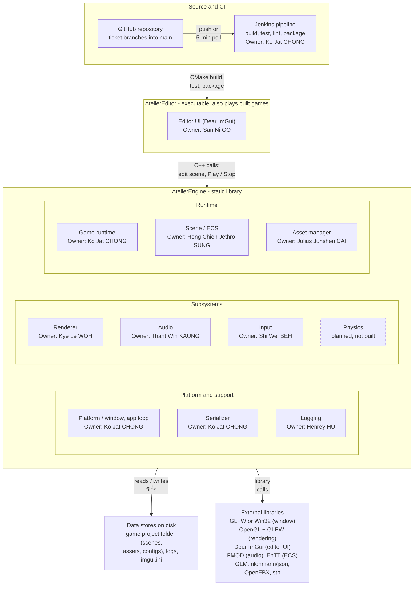

# Atelier3D: Product Design Document

| | |
|---|---|
| Team | SayReal |
| Module | GAM300 Project 5 (UXG3400 / CSD3401), Fall 2026 |
| Product | Modular 3D programming software |
| Repository | https://github.com/L1nceLin/Atelier3D |
| Version | 1.0 draft for Milestone 1 |

This is the Markdown version of the team's Product Design Document (PDD). Everything from [Project overview](#project-overview) to [Main features](#main-features) follows PDD v1.0. The sections marked **Draft** are headings without content in PDD v1.0; they are filled in here from the repository as it stands at Milestone 1 and from the [project proposal](../proposal.md), and need team review before they go into the PDD.

## Contents

- [Project overview](#project-overview)
- [Team and roles](#team-and-roles)
- [Problem statement](#problem-statement)
- [User research](#user-research)
- [Main function](#main-function)
- [Main features](#main-features)
- [General usability](#general-usability)
- [Screen inventory](#screen-inventory)
- [Minimum viable product (MVP)](#minimum-viable-product-mvp)
- [Technical approach](#technical-approach)
- [High-level architecture](#high-level-architecture)
- [Data model](#data-model)
- [Risks and mitigations](#risks-and-mitigations)

## Project overview

Atelier3D is a custom 3D engine and visual programming environment designed to help beginners learn how games and programming work by making code execution visible.

Inspired by the simplicity of Scratch, Atelier3D brings block-based programming into a real-time 3D environment. Users can create 3D scenes, attach logic to objects, run their programs, and directly see how their blocks affect the world.

## Team and roles

| Member | Role |
|---|---|
| Ko Jat Chong | Tech Lead, Engine Champion, Backend Lead |
| Sheng Lin | Product Manager |
| Kye Le Woh | Graphics Champion, API Champion |
| Hong Chieh Jethro Sung | Physics Champion, Scripting Champion |
| Julius Junshen Cai | Animation Champion, Database Champion |
| Shi Wei Beh | Tools Champion |
| Thant Win Kaung | Audio Champion |
| San Ni Go | UI Design Champion, Auth Champion |
| Henrey Hu | Debugging Tools Champion |

## Problem statement

Learning programming can be difficult because program execution is mostly invisible. A beginner may understand what a block says, but not necessarily understand:

1. Which instruction is currently running
2. Why a condition did or did not execute
3. Which object is controlled by a piece of logic
4. What caused a variable to change
5. Why an object behaved differently from what they expected

Traditional block programming tools make syntax easier to learn, but the transition from blocks to traditional programming can still feel disconnected. Professional game engines provide powerful 3D tools, but their complexity can make them difficult for beginners to understand.

Atelier3D sits between these two approaches. It combines:

1. A lightweight 3D editor
2. Scratch-inspired visual programming
3. A custom runtime
4. Live execution visualisation
5. Beginner-oriented debugging
6. A gradual path towards C++

The goal is not to compete with professional game engines in rendering quality or production features. Atelier3D is designed as a learning environment that happens to produce small playable 3D games.

## User research

### User groups

**Primary users: secondary school teenagers**

| Group | Ages | Demographics | Behaviour | Needs | Sample use case |
|---|---|---|---|---|---|
| 1 | 13–17 | Students interested in games, technology, digital art or creative projects. May have little or no knowledge of C++ or traditional programming syntax. | Curious about how games work and willing to experiment, but may rely on trial and error when learning unfamiliar concepts. | Visual programming, understandable terminology, beginner-friendly tutorials, and the ability to immediately see how their code affects the 3D environment. | A student wants to learn how game logic works. They create a 3D scene, add a character, use block-based programming to make the character move when a key is pressed, and watch the corresponding blocks execute in the runtime. |
| 2 | 13–17 | Secondary school students with varied academic backgrounds and limited formal programming experience. May have some exposure to games, Scratch, Roblox or other creative software. | Learn through experimentation and visual feedback. Comfortable exploring digital interfaces but may become frustrated when outcomes are unclear. Often prefer hands-on activities over lengthy explanations. | Simple and approachable programming tools, clear visual feedback, immediate cause-and-effect relationships, guided learning objectives, error recovery, and opportunities to experiment safely. | A student experiments with an [IF] condition by changing a block and observing how the character behaves differently when the condition is true or false. |

**Secondary users: parents, guardians and educators**

| Group | Ages | Demographics | Behaviour | Needs | Sample use case |
|---|---|---|---|---|---|
| 1 | 35–60 | Parents or guardians of teenagers interested in programming, games or technology. | Encourage and support their child's learning but may have limited programming knowledge themselves. | Simple onboarding, understandable terminology, safe experimentation, and clear indicators of learning progress. | A parent helps their child explore Atelier3D at home and observes the child's completed projects and learning objectives. |

> PDD v1.0 titles this table "Teachers / Educators", but its only row describes parents and guardians. Educators are still a secondary audience (Teaching Mode is for them too); a row for them should be added to the PDD.

### Competitor analysis

**Scratch.** A beginner-friendly block-based programming platform developed to help young users learn programming through interactive projects and games. It focuses on making programming accessible through visual blocks rather than traditional code.

| Strengths | Weaknesses | Opportunities | Threats |
|---|---|---|---|
| Extremely beginner-friendly | Mainly 2D environment | Add more advanced concepts | Newer educational platforms |
| Large educational community | Limited advanced game development features | Expand into 3D learning | Students outgrow the platform |
| Simple block programming | Limited physics and 3D interactions | Better transition to real programming languages | Roblox and game-creation tools attracting learners |
| Free and accessible | Difficult transition to professional engines | | |
| Many tutorials and resources | Minimal debugging and execution visualisation | | |

| Scratch | Atelier3D |
|---|---|
| 2D environment | Real-time 3D environment |
| Focus on block coding | Focus on block coding + visible execution |
| Limited debugging | Runtime visualisation and variable tracking |
| No professional code view | Read-only C++ equivalent |
| General creativity tool | Designed specifically for learning how games and programming work |

**Construct 3.** A game development engine that allows users to create games primarily through visual event-based programming without requiring extensive coding knowledge. It is designed for rapid game creation and prototyping, particularly for 2D games.

| Strengths | Weaknesses | Opportunities | Threats |
|---|---|---|---|
| Easy event-sheet programming | Primarily designed for 2D games | Improve 3D support | Roblox and Unity attracting creators |
| Fast game prototyping | Limited educational guidance | Expand educational features | Other no-code engines |
| Browser-based | No integrated teaching mode | Add stronger learning systems | Free alternatives |
| Supports exporting games | Programming concepts are less visible | | |
| Includes some 3D features | Not designed for beginner programming education | | |

| Construct 3 | Atelier3D |
|---|---|
| Focus on making games quickly | Focus on learning programming |
| Limited execution feedback | Live execution visualisation |
| Event sheets | Visual blocks |
| No educational objectives | Teaching Mode |
| No code translation | C++ representation |

**Roblox Studio.** A 3D game development platform that allows users to build, program, test and publish interactive experiences within the Roblox ecosystem. It provides more advanced development capabilities but can be more complex for users who are completely new to game development.

| Strengths | Weaknesses | Opportunities | Threats |
|---|---|---|---|
| Full 3D game engine | Steeper learning curve | Expand educational content | Competition from Unity and Unreal |
| Huge asset ecosystem | Requires scripting for advanced systems | More beginner learning tools | New AI-assisted tools |
| Large community | Interface can overwhelm beginners | Better visual scripting systems | Newer and easier-to-use platforms |
| Multiplayer support | Less focused on teaching fundamentals | | |
| Real-world publishing platform | Debugging concepts can be difficult | | |

| Roblox Studio | Atelier3D |
|---|---|
| Professional creator platform | Educational platform |
| Lua/Luau scripting | Block programming |
| Learn by building games | Learn by seeing execution |
| Large feature set | Focused learning environment |
| Asset ecosystem | Teaching and sandbox modes |

### User stories

**User story 1: learning programming.** As a secondary school student with little programming experience, I want to use visual blocks to control objects in a 3D environment, so that I can understand how programming logic affects the game world.

Expected outcomes:

1. User can identify and use basic programming blocks without extensive guidance.
2. User can connect blocks to create a simple sequence of actions.
3. User can see the changes caused by their blocks in the 3D environment.
4. User can understand the relationship between a block and the object it affects.
5. User can successfully create a simple interaction, such as making an object move when an event occurs.

**User story 2: understanding and debugging.** As a beginner learning programming, I want to see which blocks are currently executing and how they change the 3D scene, so that I can identify what my code is doing and understand why something happened.

Expected outcomes:

1. User can identify which block is currently being executed.
2. User can observe changes to variables while the program is running.
3. User can identify which object is being affected by a block.
4. User can use runtime feedback to determine why an expected action did or did not occur.
5. User can make corrections to their blocks based on the feedback provided.

### Core user journeys

**Journey 1: guided learning**

```text
Open Atelier3D → Select Teaching / Tutorial Mode → Choose learning objective → Read / view instructions
→ Create or open 3D scene → Add / select object → Create block logic → Run program
→ Observe blocks executing + 3D result → Identify and fix errors if needed → Automatic objective check
→ Complete objective / continue to next lesson
```

> In the PDD v1.0 diagram the arrows of the second row point right to left, which reads as "Run program" before "Create block logic", and the first row repeats two boxes. The order above is the intended one.

**Journey 2: create and experiment**

```text
Open Atelier3D → Select Sandbox Mode → Create new project → Build 3D scene → Add and modify objects
→ Attach block logic → Run program → Observe real-time behaviour → Modify blocks / variables
→ Run and test again → Save / export project
```

### Target user persona

**Ethan, 16.** Secondary 4 student, Singapore. Archetype: explorer. Frequently used software: Construct 3, Scratch and Minecraft.

- **Goal:** learn basic programming logic through block-programming a simple game.
- **About:** Ethan enjoys playing games and experimenting with technology. He has tried Scratch before but has little experience with traditional programming or 3D game engines.
- **Frustrations:** programming syntax can be confusing, and errors are difficult to understand. As a starter, it is hard for him to tell which part of the code caused an action.
- **Motivations:** experiment and explore (he enjoys trying different things and seeing what happens); express creativity (he wants to design his own 3D worlds, characters and interactions).
- **Needs:** simple visual programming blocks with immediate visual feedback and clear explanations of errors.

## Main function

The application contains an editor and a runtime that are designed to be run together. Edits made in the editor are directly reflected in the runtime panel, showing changes, effects and real-time updates.

The solution has five parts:

1. A lightweight 3D scene editor with objects, transforms, lighting, cameras, materials, collision and simple physics.
2. A block programming language covering events, movement, variables, conditions, loops, functions, object lifecycle, audio and visuals.
3. A runtime that executes block logic and reports the currently executing block, variable values and events back to the editor in real time.
4. A read-only C++ view that shows the equivalent C++ for the learner's blocks, with user-authored C++ introduced in a later version for defined extension points.
5. Two working modes: a Teaching Mode with objectives and automatic checks, and a Sandbox Mode for free creation and export.

The design principle that holds these together is that the learner should always be able to answer three questions without leaving the 3D view: **what is controlling this object, what is happening right now, and what changed.**

## Main features

Features are labelled by intended release: **MVP** is the first working prototype, **V2** is the second iteration, and **Future** indicates work that is realistic only beyond the initial project.

| Feature | Description | Release |
|---|---|---|
| 3D scene editor | Create, select, transform, duplicate and delete objects; lighting; camera; materials; collision volumes; simple physics | MVP |
| Block programming | Drag-and-drop blocks grouped into events, movement, variables, conditions, loops, objects, audio, visuals and functions | MVP |
| Real-time execution | Run and stop the scene inside the editor without a build step | MVP |
| Execution highlighting | The block being executed is highlighted while the game runs | MVP |
| In-world debugger | A floating panel beside the selected object showing its variables, current event and current block | MVP |
| Step debugging | Pause, resume, step one block at a time, and set breakpoints on blocks | MVP |
| Object inspector | Transform, model, material, physics, collision, audio, variables and attached logic for the selected object | MVP |
| Beginner error messages | Plain-language explanations linked to the block and object that caused the problem | MVP |
| Asset import | OBJ models, PNG and JPG textures, WAV and OGG audio | MVP |
| Teaching Mode | Prepared scenes with an objective and an automatic check, introduced in a fixed order | MVP |
| Sandbox Mode | An empty project with full editor access | MVP |
| Windows export | Package a project into a standalone Windows executable | MVP |
| C++ view | Read-only generated C++ for the learner's block logic, kept in sync with the blocks | V2 |
| Reusable logic components | Save a block group as a named component and attach it to several objects | V2 |
| Logic dependency map | A generated graph of objects, events, variables and functions, with click-through navigation | V2 |
| Execution history | A recorded timeline of variable changes and events for the last run | V2 |
| Hint system | Progressive hints attached to Teaching Mode challenges | V2 |
| User-authored C++ | Writing behaviour components in C++ against a documented engine API | V2 / Future |
| Custom shaders and materials | Importing or editing shader code for advanced users | Future |
| Additional export targets | Linux, Android and web | Future |
| Classroom features | Assignment distribution, submission and review | Future |
| Learning analytics | Progress and error pattern reporting | Future |
| AI tutor | Optional assistant that explains errors and gives hints rather than answers | Future |

> The README and the [project proposal](../proposal.md) record refinements made after PDD v1.0, all deferred beyond the MVP, to be folded into the next PDD version: a logic visualiser that shows the logic attached to each object; a level visualiser that gives an overview of a game's levels; reusable logic components that can be shared between levels as well as between objects; and a C++ view the learner can swap with the block view of the same logic.

## General usability

**Draft.** Usability goals taken from the user needs above, how the design meets each one, and what already works at Milestone 1.

| Goal | Where it comes from | How the design meets it | At Milestone 1 |
|---|---|---|---|
| Understandable terminology | Primary and secondary user needs | Block and error text in plain language; no engine jargon in the learner-facing interface | Engine messages are plain sentences that name the file involved. Learner-facing block and lesson text does not exist yet |
| Immediate cause and effect | Primary group 2, user story 1 | Edits show in the runtime straight away; run and stop without a build step | Play, Pause and Stop work in the editor; Inspector edits reach the running game on the next frame |
| Visible execution | User story 2 | Execution highlighting and the in-world debugger beside the object | Not built yet (needs the block system) |
| Error recovery | Primary group 2, persona frustrations | Beginner error messages linked to the block and object | Undo and redo; Stop restores the scene as it was before Play; a broken scene file shows an error instead of crashing |
| Safe experimentation | Primary and secondary user needs | Sandbox Mode; nothing the learner does can break the project | Missing or broken files fall back to defaults and placeholders instead of crashing |
| Guided learning | Primary group 2, journey 1 | Teaching Mode objectives, automatic checks and lessons in a fixed order | The Modes page and Notes window exist; objectives and checks are not built yet |

## Screen inventory

**Draft.** The screens from the two user journeys and the editor layout, with their state in the repository at Milestone 1. Wireframes and mockups belong in `docs/design/ui-ux/`, which is still empty.

| Screen / window | Purpose | Journey | State at Milestone 1 |
|---|---|---|---|
| Modes page (home) | The first screen: modes with tutorial cards, and Open Workspace | 1 | Built as a page of tutorial notes; choosing a lesson with an objective is planned |
| Menu bar | File (scenes), Edit (undo, copy, paste), Project (games, build, controls), Window (windows, layout); Play / Pause / Stop | 1, 2 | Built |
| New Game window | Name a game and pick a template (empty, or a demo scene) | 2 | Built |
| Viewport | The scene in 3D or 2D: select, move / rotate / scale, look around; shows the running game in Play mode | 1, 2 | Built |
| Hierarchy | The scene's objects: create, select, rename, duplicate, delete | 1, 2 | Built |
| Inspector | The selected object's components and properties; add and remove components | 1, 2 | Built for transform, model and texture, light, camera, audio source and player; variables and attached logic are planned |
| Assets and Loaded Assets | The game's models, textures and sounds: search, filter by type or favorites, preview on hover, then click or drag one onto an object; what the running scene has loaded | 2 | Built |
| Console | Log messages with level, category and text filters | 1, 2 | Built |
| Controls | View and remap the game's input actions | 2 | Built |
| Notes | The notes of the tutorial opened from the Modes page | 1 | Built |
| Diagnostics and Audio | Developer tools: frame rate, entity spawning, input state, the sound bank | — | Built |
| Block editor | Block palette and canvas | 1, 2 | Planned |
| Debugger and in-world debugger | Execution state, variables, stepping, breakpoints | 1, 2 | Planned |
| Lesson instructions and objective check | Read the instructions; see whether the objective is met | 1 | Planned |
| Built game window | The exported game, running without the editor | 2 | Built |

## Minimum viable product (MVP)

**Draft.** The MVP is the set of features marked **MVP** in [Main features](#main-features). The project proposal defines it around one test: *a learner with no programming experience can complete a short sequence of lessons, then build and export a small original game.*

Milestone 1 delivers the tool and pipeline the MVP is built on: the engine foundations (T12–T19) and the editor workflows (F01–F13) listed in [deliverables.md](../deliverables.md) and linked to Jira in the [README](../../README.md#milestone-1-deliverables-and-jira). Measured against the PDD's MVP features, the state at Milestone 1 is:

| MVP feature | Current state | What exists, and what is missing |
|---|---|---|
| 3D scene editor | Built | Create, select, move / rotate / scale, duplicate and delete objects; directional and point lights; separate editor and game cameras; base colour and texture materials. Collision volumes and physics run on Jolt |
| Block programming | Built | Blocks attached to objects, with My Blocks, variables, sound and force blocks. `LogicRunner` runs the block tree directly: the compiler and the block VM are still to come |
| Real-time execution | Built | Play, Pause and Stop run the scene inside the editor with no build step |
| Execution highlighting | Built | The running block is highlighted |
| In-world debugger | Not started | Stepping and breakpoints are built, but not the floating panel beside the object |
| Step debugging | Built | Pause, resume, step and breakpoints on blocks |
| Object inspector | Mostly built | Transform, model and texture, light, camera, audio source and player properties, with add and remove component. Colliders, variables and attached logic have their own editors |
| Beginner error messages | Not started for blocks | Engine problems are already reported in the Console with a level, a category and the file involved |
| Asset import | Built | OBJ and FBX models and PNG / JPG textures are imported from the Inspector; WAV and OGG clips in the game's audio folder are picked in the Audio Source. Missing files get placeholders |
| Teaching Mode | Started | The Modes page with tutorial cards and the Notes window. Objectives, automatic checks and lessons are missing |
| Sandbox Mode | Built | New games (empty or from a template), scene editing, asset import, Play, block logic and build |
| Windows export | Built | **Project > Build Game** makes a standalone executable with the game's data |

## Technical approach

**Draft.** Atelier3D uses a custom C++20 engine rather than Unity, Unreal Engine or Godot, because the engine itself is part of what learners should eventually understand. The engine is custom where it is central to the product (object and scene system, runtime, block execution model, editor, debugging and project system), and established libraries are used for everything else:

| Concern | Choice |
|---|---|
| Language | C++20 |
| Build | CMake 3.20+; Visual Studio on Windows, Ninja + GCC on Linux, MinGW-w64 for Windows cross-builds |
| Windowing and input | Win32 on Windows, GLFW + X11 on Linux |
| Rendering | OpenGL 3.3, shader-based, Blinn-Phong lighting |
| Entity component system | EnTT |
| Editor interface | Dear ImGui, ImGuizmo |
| Assets | The engine's `.amodel` format, built-in OBJ loader, OpenFBX, stb_image, stb_vorbis; assimp in the asset tool only |
| Audio | FMOD Core |
| Physics | Jolt Physics |
| Scripting | Lua |
| Data | JSON (nlohmann/json) and INI-style config files |
| Tests and checks | GoogleTest, clang-format, clang-tidy, cppcheck |
| Continuous integration | Jenkins |

This table is what the code uses. The project proposal lists the stack as it was first proposed (C++17, GLFW, miniaudio, tinyobjloader, Catch2 or doctest).

**Games as data.** A game is a folder of data (settings, scenes, input actions, assets), not code. A standalone build is a copy of the runtime plus the game folder, so exporting a game needs no compiler on the learner's machine.

**Block execution (planned).** Blocks are not run directly by the editor. The block graph is compiled into an intermediate representation (IR) that a block virtual machine executes. Every IR instruction keeps the block it came from, so the runtime can report the executing block back to the editor; this is what enables execution highlighting, breakpoints, stepping and runtime inspection. Long-running blocks yield instead of freezing the editor. The C++ view is generated from the same IR.

**Quality.** The engine modules that can run without a window (the entity component system, scene files, serializers, assets, audio, input, logging and game projects) have unit tests, and Jenkins builds, tests, lints and analyses every push to `main` (see the [README](../../README.md#running-the-tests)).

## High-level architecture

### Architecture v0.1 (Milestone 1)

The architecture as built at Milestone 1: the editor application, the engine modules with their owners, the data stores, the external libraries and the Jenkins pipeline. The arrows show how the parts communicate; the groups inside AtelierEngine are by role, not strict layers, and a dashed box is planned but not built. How the components talk to each other, and what each module does, is in [architecture.md](../architecture.md).



### Target architecture (MVP)

The target architecture has three layers. The editor and the runtime run in the same process, so the editor can observe runtime state directly.

```text
+------------------------------------------------------+
|                    EDITOR LAYER                      |
| Scene Editor | Block Editor | Inspector | Debugger   |
| Teaching     | Asset Browser| Gizmos    | C++ View*  |
+---------------------------+--------------------------+
                            |  Commands / State
+---------------------------v--------------------------+
|                    RUNTIME LAYER                     |
| Object System | Event System | Block VM              |
| Renderer      | Physics      | Audio                 |
| Asset Manager | Debug Bridge                         |
+---------------------------+--------------------------+
                            |  Load / Save
+---------------------------v--------------------------+
|                    PROJECT LAYER                     |
| Scenes | Block Graphs | Models | Textures | Audio    |
| Settings | Project Metadata                          |
+------------------------------------------------------+
* V2 feature
```

| Part | Responsibility | Current state |
|---|---|---|
| Scene editor, inspector, asset browser, gizmos | Build and edit the 3D scene | Built |
| Object system | Store objects, components, variables and attached logic | Built as an entity component system, with variables and logic |
| Renderer, audio, asset manager | Draw the scene, play sound, load and share assets | Built |
| Project layer | Versioned files for settings, scenes, input actions and assets | Built, block logic included |
| Block editor and compiler | Create visual programs and convert them into the IR | Block editor built; no compiler yet |
| Event system and block VM | Dispatch events and execute the IR | Event system built; no block VM yet (blocks run directly) |
| Debug bridge and debugger | Send runtime state to the editor and display it | Stepping and breakpoints built; no in-world panel yet |
| Physics | Collision and simple rigid-body behaviour | Built on Jolt |
| Teaching system | Lessons, palette restrictions, validation | Started (Modes page and notes) |

## Data model

**Draft.** The data model as implemented at Milestone 1. The files are readable text, and the JSON files carry a format version.

```text
<game>/
├── configs/game.cfg              INI: name, window_width, window_height, start_scene
├── configs/input_actions.json    { "version": 1, "actions": { "<Action>": ["<Key>", ...] } }
├── data/scenes/<scene>.json      { "version": 8, "objects": [ <game object>, ... ] }
├── data/tutorials.editor.modes   { "version": 1, "modes": [ { "name", "tutorials": [ { "name", "code" } ] } ] }
├── data/assets.editor.favorites  { "version": 1, "favorites": [ "<asset path>", ... ] }
├── assets/                       models, textures, materials, shaders, audio
└── scripts/
```

| Entity | Fields | Notes |
|---|---|---|
| Game | Name, window width and height, start scene | A folder is a game when it has `configs/game.cfg` |
| Scene | Format version, list of game objects | A file with any other version is refused with an error |
| Game object | Id (unique in its scene), name, and the components it has | A named container: it has a position only once it has a Transform, and is drawn only once it has a Transform and a Renderable |
| Transform | Position, rotation in degrees around X / Y / Z, size, scale per axis | |
| Renderable | Built-in shape or mesh file, texture, shader, colour tint, rotation speed | Asset paths are relative to the game folder |
| Light | Type (directional, point, spot), colour, intensity, range, spot cone, enabled | |
| Camera | Field of view, near and far planes, Main camera flag | Play mode draws from the Main camera |
| Audio source | Clip, volume, loop, play on start, 3D on / off, minimum and maximum distance, bus (sfx or music) | |
| Player | Speed, fast multiplier, look sensitivity, follow-camera distance, height and pitch | The object the move keys drive in Play mode |
| Input action | Name, list of keys and mouse buttons | The engine's own actions cannot be removed; games can add their own |
| Tutorial notes | Modes, each with named tutorials and their notes | Saved per game |
| Asset (runtime only) | Path, type, reference count, disk reads, placeholder flag | Shared by the resource manager; not saved |

Planned additions for the MVP: block graphs and variables attached to game objects, collision and physics components, and lesson definitions for Teaching Mode (prepared scene, objective, allowed blocks, check).

## Risks and mitigations

**Draft.** The risks, their impact and likelihood, and the mitigations are the team's, from the [project proposal](../proposal.md) (section 16). The last column is the state of the repository at Milestone 1.

| Risk | Impact | Likelihood | Mitigation | At Milestone 1 |
|---|---|---|---|---|
| Engine development consumes the schedule | High | High | Fix the visual target early and use established libraries | Rendering, the entity component system, assets, audio, input and the editor are in place, built on EnTT, Dear ImGui, FMOD, OpenFBX and stb |
| Scope creep | High | High | Maintain a fixed MVP and require additions to replace existing scope | Features are labelled MVP / V2 / Future; M1 scope was fixed as T12–T19 and F01–F13 |
| Virtual machine defects cause confusing behaviour | High | Medium | Automated tests and reference projects | The VM is not started; the unit test suite and CI it will be tested with exist |
| Debugging reduces performance | Medium | Medium | Throttle reporting and sample state | Not started; an FPS and entity count overlay exists to measure it |
| C++ integration takes longer than expected | Medium | Medium | Keep the C++ phase conditional | The C++ view is a V2 feature |
| Asset import failures | Medium | High | Validate imports and handle bad input without crashing | Missing or unreadable assets get a placeholder and a Console warning |
| The editor becomes intimidating | High | Medium | Usability testing and progressive disclosure | Not tested with users yet |
| Teaching content takes too long | Medium | High | Define the lesson format early and author lessons in parallel | The lesson format is not defined yet |
| Validation rejects correct solutions | High | Medium | Validate observable behaviour with tolerances and multiple correct solutions | Not started |
| Data loss | High | Medium | Atomic saves, autosave, a versioned project format | Scene files are versioned and round-trip tested; atomic saves and autosave are not built |
| Team member unavailability | High | Low | Frequent commits, documentation and contingency | Work is on per-ticket branches with one owner per deliverable; setup and architecture are documented |
| Learners do not find the visualisation useful | High | Low | Test the hypothesis early with prototypes and usability trials | Not tested yet |
